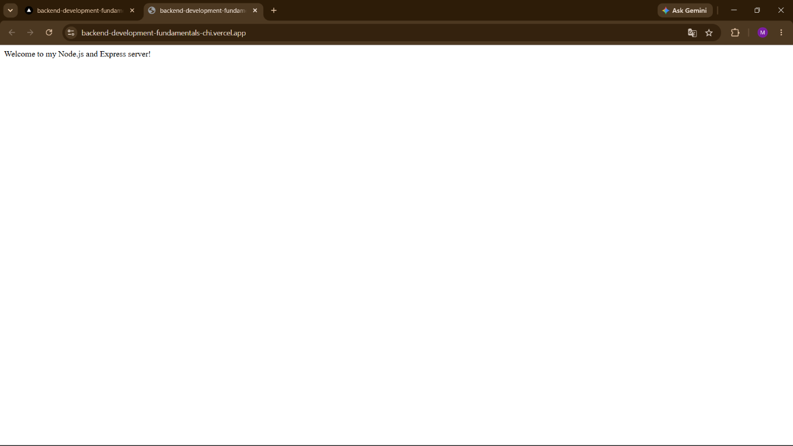
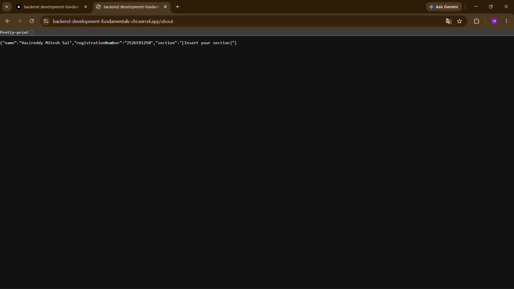
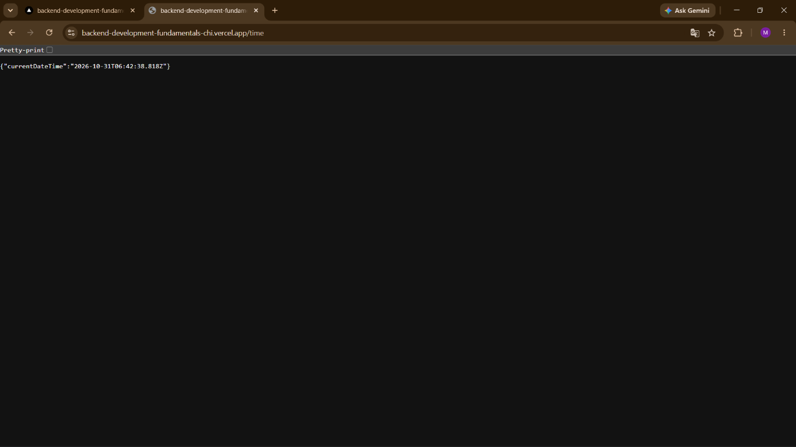

# Lab 1: Node.js and Express Server

## Student details

- **Name:** Vasireddy Mitesh Sai
- **Registration Number:** 252U1R1250
- **Section:** CSE-2E-211

## Live deployment

[https://backend-development-fundamentals-chi.vercel.app/](https://backend-development-fundamentals-chi.vercel.app/)

## Endpoints

| Method | Endpoint | Description |
|---|---|---|
| GET | `/` | Displays a welcome message |
| GET | `/about` | Returns the student's name, registration number, and section as JSON |
| GET | `/time` | Returns the current date and time as JSON |
| GET | Any unknown path | Returns a 404 response |

## Screenshots

### Welcome route



### About route



### Time route



### 404 response


## Run locally

```bash
npm install
npm start
```

The server listens on port `3000` by default. If a `PORT` environment variable is set, the server uses that port instead.
