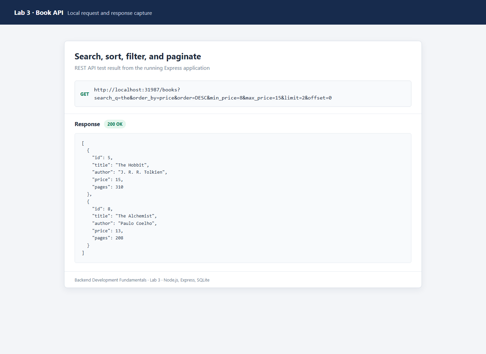

# Lab 3: REST API, query parameters, validation, debugging

**Name:** Vasireddy Mitesh Sai

**Registration number:** 252U1R1250

**Section:** CSE-2E-211

**Printable assignment:** [Download the Lab 3 PDF](./Assignment-3-REST-API.pdf). The live deployment link is left blank in the PDF so it can be added after deployment.

**Live link:** Not deployed yet. A Neon `DATABASE_URL` and a Vercel project configured with this repository's `lab-03` root directory are required. Follow the deployment steps below, then replace this line with the public URL.

## Run locally

Requires Node.js and npm. From a terminal opened in `lab-03/`:

```powershell
npm install
npm run seed
npm start
```

The API listens on `http://localhost:3000` by default. To use another port, set `PORT` before `npm start`. For automatic restart while editing, run `npm run dev`. The SQLite database is created as `books.db` in this folder and is ignored by Git.

To run the automated API tests:

```powershell
npm test
```

## Environment variables

| Variable | Required when | Purpose |
|---|---|---|
| `PORT` | Optional locally; supplied by many hosts | Port for the HTTP server |
| `DATABASE_URL` | Deploying to Vercel or using Neon locally | Neon Postgres connection string; keep it secret and never commit it |

For Neon locally, set `DATABASE_URL` in the terminal, then run `npm run setup:neon` once before starting the server. In PowerShell, use `$env:DATABASE_URL = "your-private-connection-string"`; do not paste the real value into source code, screenshots, or GitHub. On Vercel, add `DATABASE_URL` in the project's Environment Variables for the environments you deploy.

## Endpoints

| Method | Path | Description |
|---|---|---|
| GET | `/books` | List books, optionally searched, sorted, price-filtered, and paginated |
| GET | `/books/:bookId` | Get one book by its positive integer ID |
| POST | `/books` | Create a book; returns `201` |
| PUT | `/books/:bookId` | Replace a book; returns `200` or `404` |
| DELETE | `/books/:bookId` | Delete a book; returns `200` or `404` |

### GET `/books` query parameters

All parameters are optional. Defaults: `order_by=id`, `order=ASC`, `limit=10`, and `offset=0`.

| Parameter | Example | Behavior |
|---|---|---|
| `search_q` | `?search_q=the` | Partial, case-insensitive title match |
| `order_by` | `?order_by=price` | Sort by `id`, `title`, `author`, `price`, or `pages` |
| `order` | `?order=DESC` | Sort direction: `ASC` or `DESC` |
| `limit` | `?limit=5` | Page size from 1 to 100 |
| `offset` | `?offset=10` | Number of matching rows to skip |
| `min_price` | `?min_price=8` | Include books at or above this price |
| `max_price` | `?max_price=15` | Include books at or below this price |

Combine parameters with `&`, for example:

```text
http://localhost:3000/books?search_q=the&order_by=price&order=DESC&min_price=8&max_price=15&limit=5&offset=0
```

Book request JSON (use **Body → raw → JSON** in Postman):

```json
{
  "title": "The Hobbit",
  "author": "J. R. R. Tolkien",
  "price": 15,
  "pages": 310
}
```

Title and author must be non-empty strings, price must be a non-negative integer, and pages must be a positive integer. Values are sent to the database as parameters; sort columns are restricted to an allowlist.

## Postman test list

Start the server, create a Postman collection, and set `baseUrl` to `http://localhost:3000`. Run these cases in order. For update and delete, use the `bookId` returned by the create request.

| Test | Request | Expected result |
|---|---|---|
| List all | `GET {{baseUrl}}/books` | `200`, JSON array |
| Search, sort, filter, paginate | `GET {{baseUrl}}/books?search_q=the&order_by=price&order=DESC&min_price=8&max_price=15&limit=2&offset=0` | `200`, matching books ordered by price |
| Check defaults | `GET {{baseUrl}}/books?search_q=the` | `200`, at most 10 matches, ordered by ID ascending |
| Get existing book | `GET {{baseUrl}}/books/1` | `200`, book JSON |
| Get missing book | `GET {{baseUrl}}/books/99999` | `404`, `{"message":"Book not found"}` |
| Reject invalid ID | `GET {{baseUrl}}/books/abc` | `400`, JSON message |
| Create book | `POST {{baseUrl}}/books` with the JSON body above | `201`, message and `bookId` |
| Reject invalid body | `POST {{baseUrl}}/books` with `{"title":"Test","price":"not-a-number"}` | `400`, clear JSON message |
| Update existing book | `PUT {{baseUrl}}/books/{{bookId}}` with a valid JSON body | `200`, success message |
| Update missing book | `PUT {{baseUrl}}/books/99999` with a valid JSON body | `404`, JSON message |
| Delete existing book | `DELETE {{baseUrl}}/books/{{bookId}}` | `200`, success message |
| Delete missing book | `DELETE {{baseUrl}}/books/99999` | `404`, JSON message |
| Reject invalid query | `GET {{baseUrl}}/books?order_by=secret` | `400`, JSON message |

All error responses use the shape `{"message":"..."}`. POST and PUT must use valid JSON and the book fields shown above.

## Debugging notes

- **`EADDRINUSE`**: another process is already using the port. Stop that process or start this server on another port (for example, in PowerShell: `$env:PORT=3001; npm start`).
- **Wrong import path / `MODULE_NOT_FOUND`**: check the filename and relative path from the importing file; these scripts import local files with `./`, such as `require("./sample-books.json")`.
- **`no such table: book`**: make sure the connection uses the `book` table. The SQLite server creates it at startup; run `npm run seed` to also insert sample data. For Neon, run `npm run setup:neon` once with `DATABASE_URL` set.
- **Missing `await`**: database operations return promises. Await them before reading results or sending responses; otherwise a response may contain an unresolved value or a failure may happen after the route has responded.
- **Unexpected `500`**: read the server terminal error, confirm `DATABASE_URL` is set only when using Neon, and check that the database/table is initialized. The API intentionally returns a generic JSON message rather than exposing database details to clients.

## Deployment to Vercel with Neon

1. Create a Neon Postgres database and keep its connection string private.
2. Set `DATABASE_URL` in the Vercel project's Environment Variables. Do not add a real connection string to this README or commit it.
3. If this is a fresh database, set `DATABASE_URL` locally in PowerShell and run `npm run setup:neon` once to create the table and sample rows.
4. Import the existing GitHub repository into Vercel (or create a project for it) and set **Root Directory** to `lab-03`. Set `DATABASE_URL` for Production and Preview as appropriate.
5. Deploy, test the public `/books` URL, and replace the Live link at the top of this README.

## Screenshots to capture

Save actual Postman screenshots inside `lab-03/screenshots/` using these filenames. Capture the full Postman window so the request URL, status code, and response body are visible. Do not include Neon credentials, `.env` values, or other secrets in screenshots.

1. `get-books.png`: successful `GET /books` showing the JSON array.
2. `filtered-books.png`: `GET /books` with `search_q`, sorting, price range, and pagination visible in the URL and response.
3. `get-book.png`: successful `GET /books/1`.
4. `post-book.png`: successful POST, with `201` and the response `bookId`; show the request JSON in the same capture if legible.
5. `validation-error.png`: invalid POST body and the `400` JSON message.
6. `put-book.png`: successful PUT showing `200`.
7. `delete-book.png`: successful DELETE showing `200`.
8. `not-found.png`: a missing book request showing `404`.

After saving each image, add it to this README with the matching Markdown form, for example:

```markdown

```

If deployed, also capture the public API response and a Neon table view with sensitive connection information excluded. For a submission before deployment, capture the local Postman calls listed above.

## Viva preparation

- A **query parameter** filters or changes a collection request (for example, `/books?order_by=price`); a **path parameter** identifies a resource (for example, `/books/3`).
- **Stateless** means each request contains the information needed to process it; the server does not depend on conversational state from a previous request.
- Use **400 Bad Request** for invalid input and **404 Not Found** when a validly requested record does not exist.
