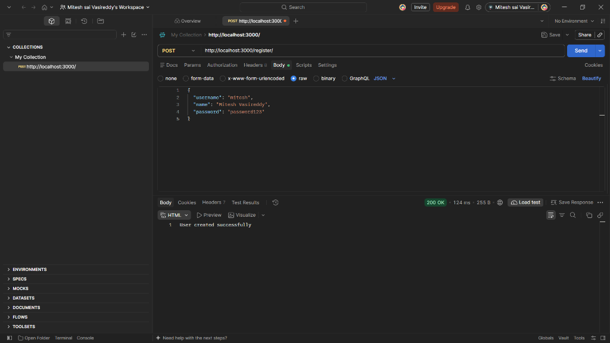
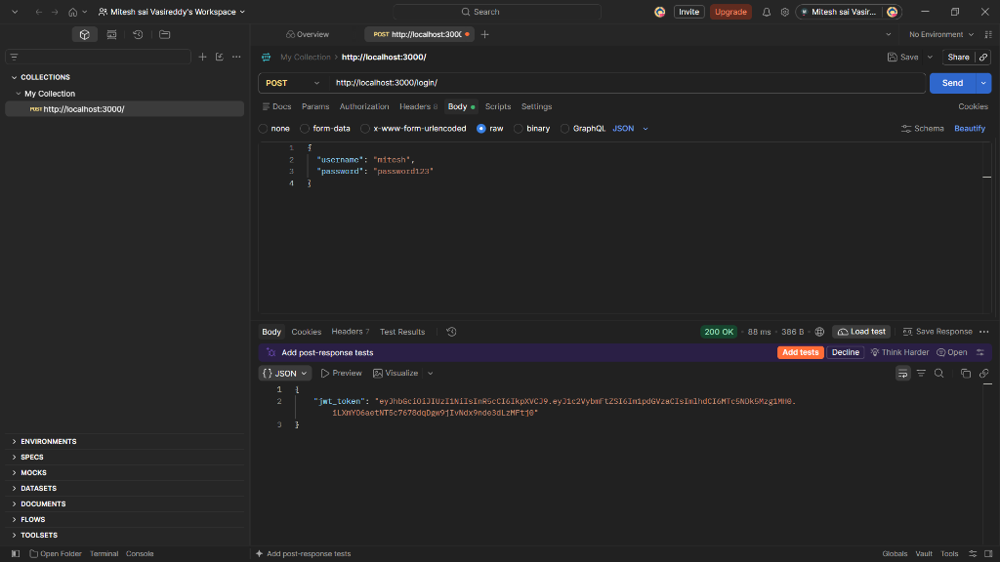
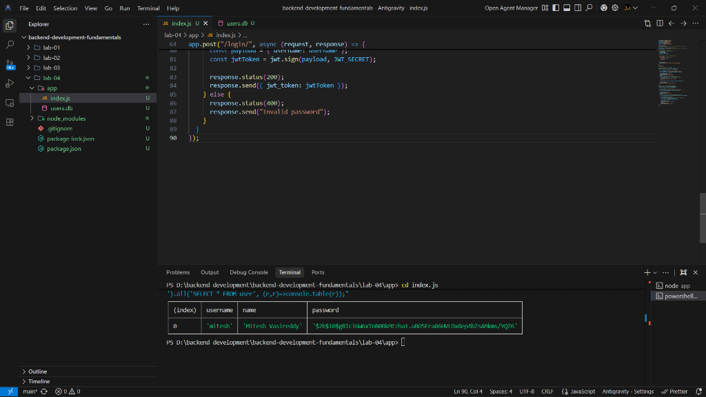
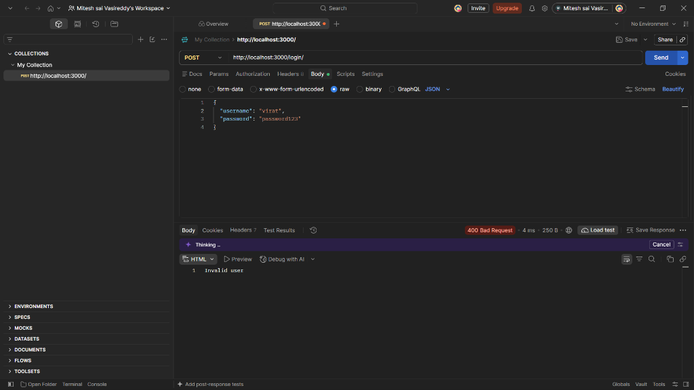

# Lab 4: Registration, Login and JWT

## Student Details

- **Name:** Vasireddy Mitesh Sai
- **Registration Number:** 252U1R1250
- **Section:** CSE-2E-211

## Live Link

Not applicable — this lab uses a local SQLite database with bcrypt hashing, which requires native binaries not supported on serverless platforms like Vercel.

## How to Run

Requires Node.js (v18+) and npm. From a terminal opened in `lab-04/`:

```bash
npm init -y
npm install express sqlite sqlite3 bcrypt jsonwebtoken
npm install
cd app
node index.js
```

The server starts at `http://localhost:3000`. No environment variables are needed for this lab. The JWT secret is kept in a constant (`MY_SECRET_KEY`) for now and will be moved to `.env` in Lab 8.

> **Note:** Do not commit `node_modules/` or `users.db`. Both are listed in `.gitignore`.

## Endpoints

| Method | Path | Description |
|--------|------|-------------|
| POST | `/register/` | Register a new user with username, name, and password |
| POST | `/login/` | Login with username and password; returns a JWT token on success |

### POST `/register/`

**Request body (raw JSON):**

```json
{
  "username": "mitesh",
  "name": "Mitesh Vasireddy",
  "password": "password123"
}
```

**Responses:**

| Status | Body | Condition |
|--------|------|-----------|
| 200 | `User created successfully` | New user registered |
| 400 | `User already exists` | Username already taken |

### POST `/login/`

**Request body (raw JSON):**

```json
{
  "username": "mitesh",
  "password": "password123"
}
```

**Responses:**

| Status | Body | Condition |
|--------|------|-----------|
| 200 | `{ "jwt_token": "eyJhbGci..." }` | Valid credentials |
| 400 | `Invalid user` | Username not found |
| 400 | `Invalid password` | Wrong password |

## Screenshots

### Register — Success (200 OK)



### Login — Success (200 OK with JWT)



### Database — Hashed Passwords



### Login — Invalid User (400 Bad Request)



## Key Implementation Details

- **Password hashing:** Passwords are hashed with `bcrypt.hash(password, 10)` before storage. Plain-text passwords are never saved or logged.
- **Password comparison:** `bcrypt.compare()` checks the entered password against the stored hash.
- **JWT generation:** `jwt.sign()` creates a token with only the `username` in the payload — the password is never included.
- **Parameterised queries:** All SQL uses `?` placeholders to prevent SQL injection.
- **User table:** Created automatically on server start with `CREATE TABLE IF NOT EXISTS`.

## Viva Preparation

- **Why POST for login?** POST sends credentials in the request body (not in the URL), keeping them out of browser history, server logs, and referrer headers.
- **Hash vs encrypt?** Hashing is one-way (you cannot recover the original password); encryption is two-way (you can decrypt with a key). Passwords should be hashed, not encrypted.
- **What does `jwt.sign` need?** A payload object and a secret key. Optionally, an options object (e.g., `expiresIn`).
- **What should never go into the JWT payload?** The password, or any other sensitive data. The payload is Base64-encoded and can be decoded by anyone.
